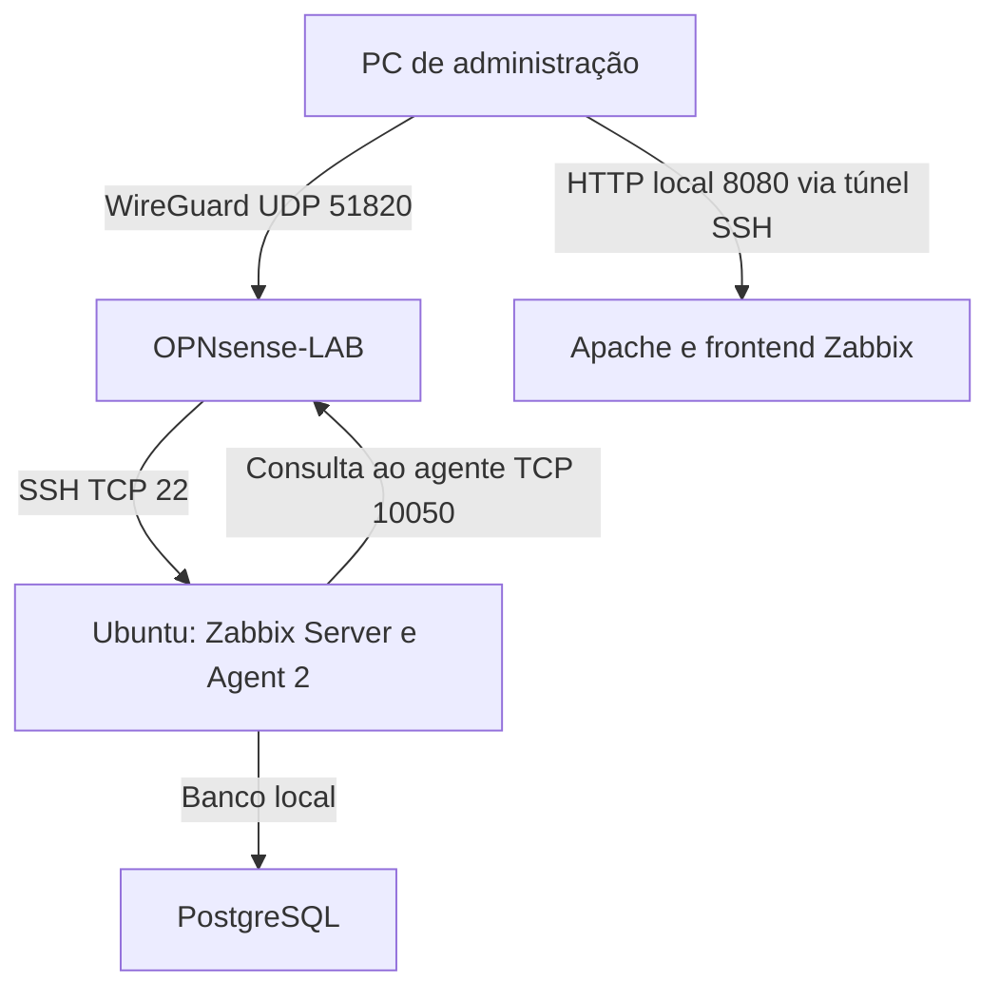

# Network Monitoring Lab

Monitoramento de Ubuntu Server e OPNsense com Zabbix 7.0 LTS, em um laboratório segmentado por VLANs no Hyper-V.

**Autor:** Artur de Novazzi Maia  
**Validação:** 16–17 de outubro de 2026

Este projeto dá continuidade ao [Enterprise Network Lab](https://github.com/artur2774/enterprise-network-lab), acrescentando visibilidade operacional à infraestrutura: coleta de métricas, gráficos, detecção de indisponibilidade e registro da recuperação.

## Resultados validados

- Zabbix 7.0.31 instalado com PostgreSQL e interface web em Apache.
- Ubuntu e OPNsense com disponibilidade ZBX verde e métricas recentes.
- Dashboard com CPU do Ubuntu, CPU user/system do OPNsense e painel de problemas.
- Agente do OPNsense acessível somente pelo servidor autorizado na configuração do agente e por uma regra específica da VLAN20.
- Teste controlado de parada do agente do Ubuntu: indisponibilidade detectada, problema gerado e recuperação automática do evento após iniciar o serviço.
- Administração do laboratório por WireGuard e acesso web por encaminhamento de porta SSH.

## Arquitetura

As VMs usam o switch LAB-LAN do Hyper-V. O OPNsense possui WAN ligada a um switch externo e interfaces para LAN/VLAN10, SERVIDORES/VLAN20 e VISITANTES/VLAN30. O servidor de monitoramento está na VLAN20.

| Componente | Endereço / configuração |
|---|---|
| OPNsense WAN | 192.168.0.32/24 |
| LAN / VLAN10 | 10.10.10.1/24 |
| SERVIDORES / VLAN20 | 10.10.20.1/24 |
| VISITANTES / VLAN30 | 10.10.30.1/24 |
| Ubuntu srv-lab | 10.10.20.10/24; 2 vCPUs; 4 GB de RAM |
| WireGuard servidor / cliente | 10.10.40.1/24 / 10.10.40.2/32 |
| Frontend | http://localhost:8080/zabbix/ no PC, com túnel SSH ativo |

Os endereços são privados e descrevem este laboratório. O acesso WireGuard validado utiliza o endpoint doméstico; acesso pela internet ainda não foi validado.

## Tecnologias

| Tecnologia | Função |
|---|---|
| Hyper-V | Virtualização e segmentação das VMs |
| Ubuntu 26.04.1 LTS | Servidor de monitoramento |
| Zabbix 7.0.31 | Coleta, histórico, gráficos e triggers |
| PostgreSQL | Banco do Zabbix |
| Apache na porta 8080 e PHP-FPM | Interface web |
| Nginx na porta 80 | Serviço HTTP do primeiro laboratório |
| OPNsense 26.7.7 | Firewall e equipamento monitorado |
| os-zabbix7-agent | Agente no OPNsense |
| WireGuard e OpenSSH | Acesso administrativo |

## Equipamentos monitorados

| Host no Zabbix | Interface do agente | Templates |
|---|---|---|
| Zabbix server (Ubuntu srv-lab) | 127.0.0.1:10050 | Linux by Zabbix agent; Zabbix server health |
| OPNsense-LAB | 10.10.20.1:10050 | FreeBSD by Zabbix agent |

O dashboard usa CPU utilization no Ubuntu e CPU user time / CPU system time no OPNsense. Essas duas séries do FreeBSD são componentes do uso da CPU, não uma medição isolada do uso total.

## Documentação

As [evidências visuais](evidencias/README.md) incluem também os dois hosts com ZBX verde e o histórico do alerta resolvido.

- [Configuração e operação](docs/configuracao.md)
- [Teste de falha e recuperação](docs/teste-de-falha.md)
- [Troubleshooting](docs/troubleshooting.md)
- [Índice de evidências](evidencias/README.md)

## Limites e próximas evoluções

O alerta validado é um evento no Zabbix, apresentado na interface. Notificações por e-mail ou outro canal não foram configuradas. A interrupção testada foi a do agente; a VM, o banco e o servidor Zabbix permaneceram ativos. Como o monitoramento está no próprio Ubuntu monitorado, uma falha total dessa VM também interrompe o Zabbix.

Evoluções possíveis: widgets de memória e tráfego, verificação de serviços HTTP, notificações externas e uma VM dedicada ao monitoramento. Latência e perda de pacotes por ICMP ainda não foram implementadas neste projeto.

Nenhuma senha, chave privada, backup integral do firewall ou configuração contendo credenciais deve ser publicada.
