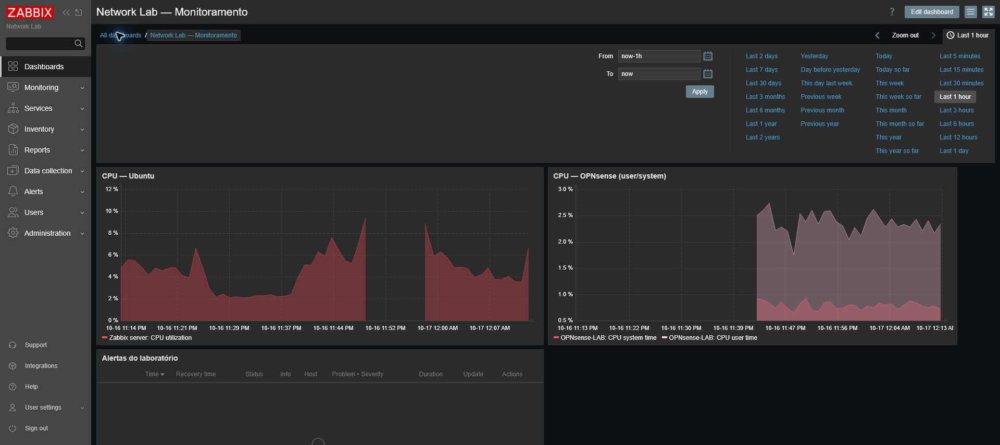
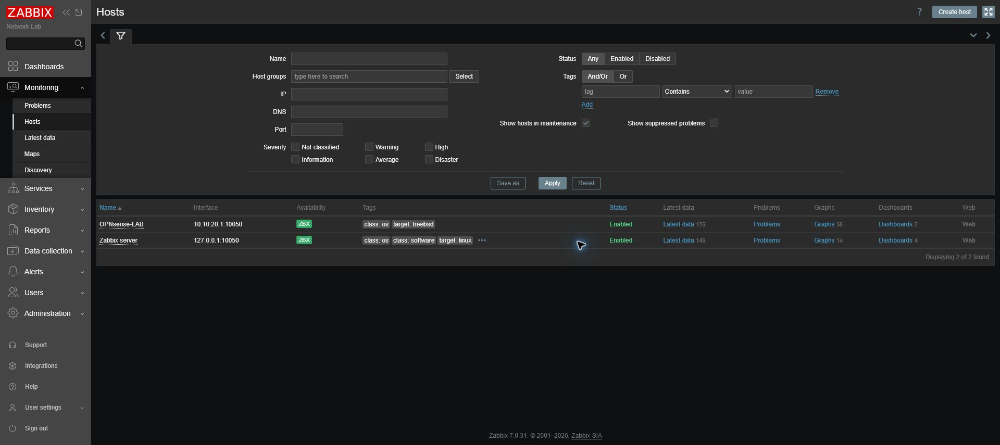
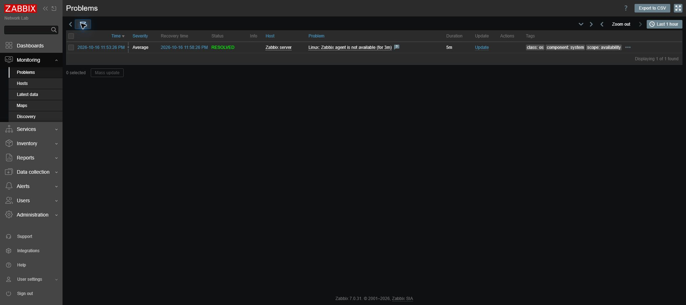

# Evidências do laboratório

Capturas realizadas diretamente no Zabbix em 17/10/2026, após o teste de falha e recuperação.

| Arquivo | Evidência | O que comprova |
|---|---|---|
| dashboard.png | Dashboard | CPU do Ubuntu e OPNsense |
| falha-recuperacao.png | Histórico | Evento RESOLVED, início 23:53:26 e recuperação 23:58:26 |
| hosts-disponiveis.png | Hosts | Dois equipamentos com ZBX verde |

## Dashboard

O gráfico do Ubuntu mostra uma lacuna durante a parada do agente. O painel de problemas está sem eventos recentes nesta captura; a recuperação está registrada no histórico abaixo.

## Disponibilidade

## Falha e recuperação

A regra de firewall está documentada em [Configuração e operação](../docs/configuracao.md).

Não publicar a captura de edição de DBPassword, backups do OPNsense ou telas com chaves e senhas. Ao adicionar imagens, conferir legibilidade e ausência de credenciais.
